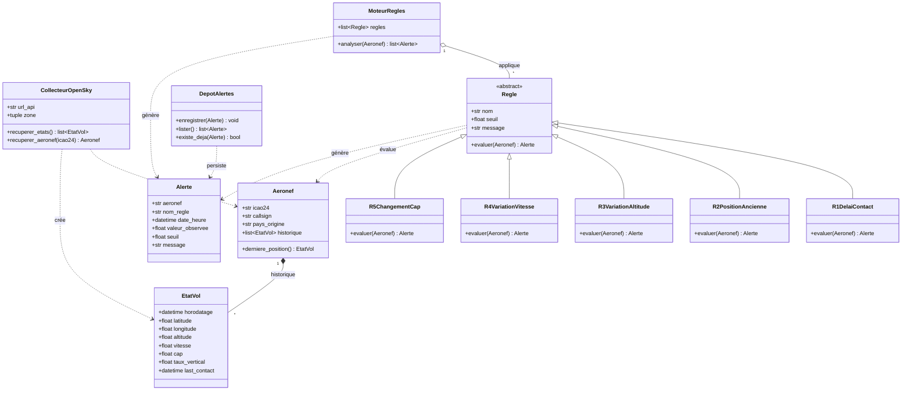

# AeroSafe — Diagramme de classes

> Conception POO du cœur métier : collecte des données de vol → moteur de règles R1-R5 → alertes en base.
> Sur GitHub, le rendu s'affiche automatiquement. Pour éditer/exporter : https://mermaid.live

## Les seuils des règles (R1 à R5)

| Règle | Classe | Seuil |
|---|---|---|
| R1 | `R1DelaiContact` | dernier contact > 5 min |
| R2 | `R2PositionAncienne` | position > 10 min |
| R3 | `R3VariationAltitude` | > 300 ft/s |
| R4 | `R4VariationVitesse` | > 100 kt en < 1 min |
| R5 | `R5ChangementCap` | > 45° en < 1 min |

## Légende des symboles UML

| Symbole | Relation | Lecture |
|---|---|---|
| `<\|--` | Héritage | `R1DelaiContact` **est une** `Regle` |
| `*--` | Composition | un `EtatVol` **n'existe pas sans** son `Aeronef` |
| `o--` | Agrégation | le `MoteurRegles` **contient** des `Regle` (qui existent indépendamment) |
| `..>` | Dépendance | une classe **utilise/crée** une autre ponctuellement |
| `<<abstract>>` | Classe abstraite | `Regle` ne s'instancie pas seule : on crée R1…R5 |

## Choix de conception

- **`EtatVol` séparé de `Aeronef`** : un aéronef garde un *historique* d'instantanés. Indispensable pour R3/R4/R5 qui comparent les valeurs **dans le temps** (variation sur moins d'une minute).
- **`Regle` abstraite + 5 sous-classes** : chaque règle a sa propre logique dans `evaluer()`, mais toutes partagent la même interface. Le `MoteurRegles` les applique sans connaître leur détail → facile d'en ajouter une 6e (prépare la tâche #20).
- **`DepotAlertes` isolé** : la persistance PostgreSQL est séparée du métier. `existe_deja()` évite les doublons d'alertes (prépare la tâche #22).
