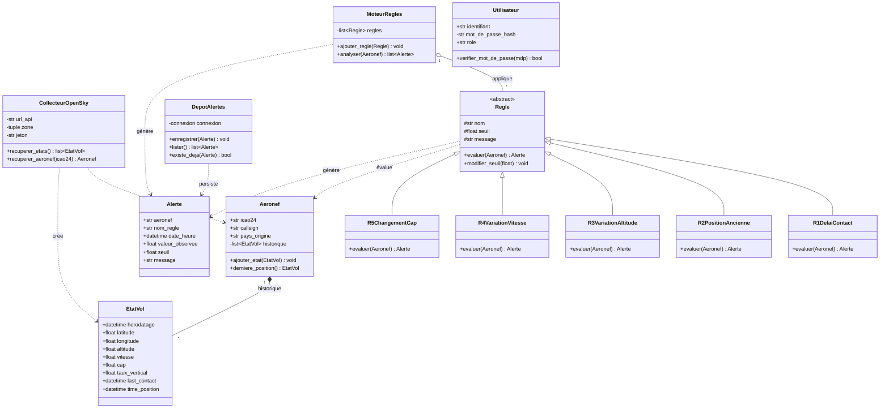

# AeroSafe — Diagramme de classes

> Conception POO du cœur métier : collecte des données de vol → moteur de règles R1-R5 → alertes en base.
> Sur GitHub, le rendu s'affiche automatiquement. Pour éditer/exporter : https://mermaid.live

## Les seuils des règles (R1 à R5)

Unités conformes aux données OpenSky (m/s).

| Règle | Classe | Seuil | Donnée utilisée |
|---|---|---|---|
| R1 | `R1DelaiContact` | dernier contact > 5 min | `last_contact` |
| R2 | `R2PositionAncienne` | position > 10 min | `time_position` |
| R3 | `R3VariationAltitude` | > 15 m/s (vertical) | `taux_vertical` |
| R4 | `R4VariationVitesse` | > 51 m/s en < 60 s | `vitesse` |
| R5 | `R5ChangementCap` | > 45° en < 60 s | `cap` |

## Légende des symboles UML

**Visibilité** (devant un attribut ou une méthode) :

| Symbole | Visibilité | Qui y accède |
|---|---|---|
| `+` | public | tout le monde (l'interface de la classe) |
| `-` | privé | uniquement l'intérieur de la classe |
| `#` | protégé | la classe **et** ses sous-classes |

**Relations** (les traits entre classes) :

| Symbole | Relation | Lecture |
|---|---|---|
| `<\|--` | Héritage | `R1DelaiContact` **est une** `Regle` |
| `*--` | Composition | un `EtatVol` **n'existe pas sans** son `Aeronef` |
| `o--` | Agrégation | le `MoteurRegles` **contient** des `Regle` (qui existent indépendamment) |
| `..>` | Dépendance | une classe **utilise/crée** une autre ponctuellement |
| `<<abstract>>` | Classe abstraite | `Regle` ne s'instancie pas seule : on crée R1…R5 |

## Choix de conception

- **`EtatVol` séparé de `Aeronef`** : un aéronef garde un *historique* d'instantanés (privé, alimenté par `ajouter_etat()`). Indispensable pour R3/R4/R5 qui comparent les valeurs **dans le temps** (variation sur moins de 60 s). `last_contact` sert à R1, `time_position` à R2.
- **`Regle` abstraite + 5 sous-classes** : chaque règle a sa propre logique dans `evaluer()`, mais toutes partagent la même interface. `nom`, `seuil`, `message` sont **protégés (`#`)** car hérités par R1…R5. `modifier_seuil()` permettra au superviseur de régler les seuils sans toucher au code (prépare #29). Le `MoteurRegles` applique les règles sans connaître leur détail → facile d'en ajouter une 6e (prépare #20).
- **Encapsulation** : les données internes sont **privées (`-`)** et manipulées via des méthodes **publiques (`+`)** — ex. `MoteurRegles._regles` n'est modifiable que par `ajouter_regle()`. `EtatVol` et `Alerte` restent publics car ce sont de simples conteneurs de données.
- **`DepotAlertes` isolé** : la persistance PostgreSQL (`-connexion`) est séparée du métier. `existe_deja()` évite les doublons d'alertes (prépare #22).
- **`Utilisateur`** : ajoutée pour le modèle de données V3 ; `mot_de_passe_hash` est **privé**, vérifié via `verifier_mot_de_passe()`. Servira à la connexion et aux rôles (#18).
