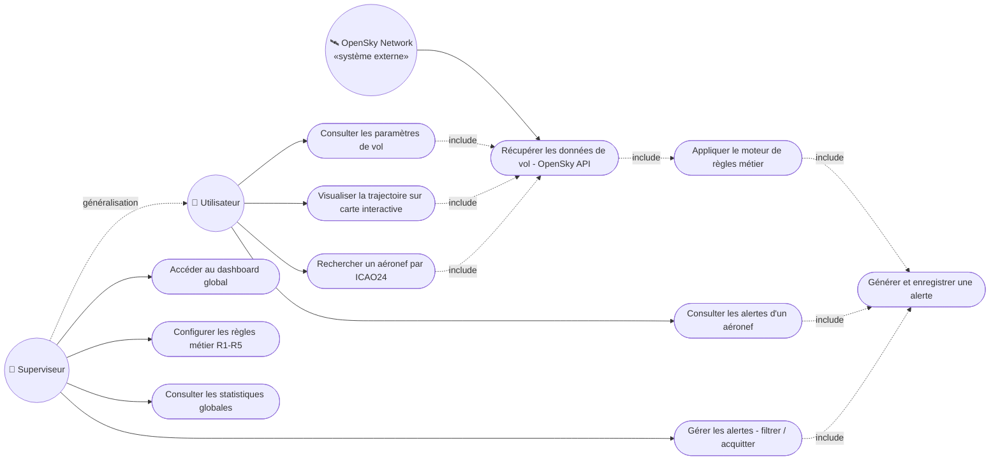

# AeroSafe — Diagramme de cas d'utilisation

> Reproduction du diagramme du cahier des charges, en Mermaid (versionnable).
> Sur GitHub, le rendu s'affiche automatiquement. Pour éditer/exporter : https://mermaid.live

## Légende

| Élément | Signification |
|---|---|
| 👤 Acteur | Personne ou système qui interagit avec AeroSafe |
| `([ ... ])` | Un cas d'utilisation (une action possible) |
| `«include»` | Un cas en inclut **toujours** un autre (dépendance obligatoire) |
| `généralisation` | Le Superviseur peut faire **tout** ce que l'Utilisateur fait, **+** ses actions propres |
