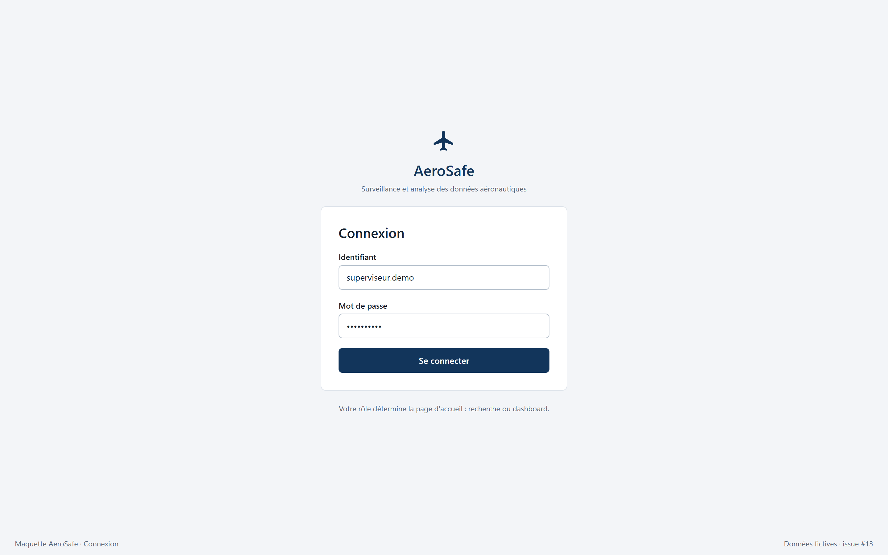
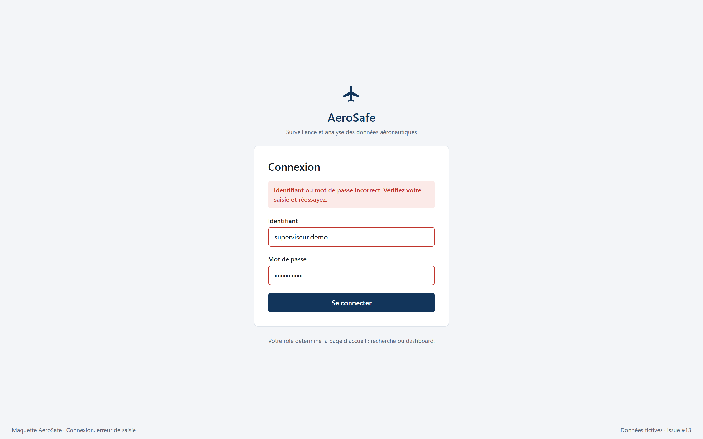
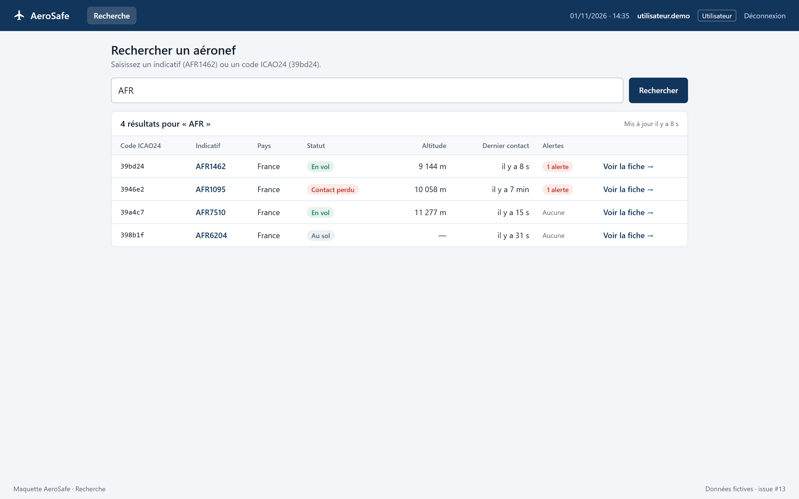
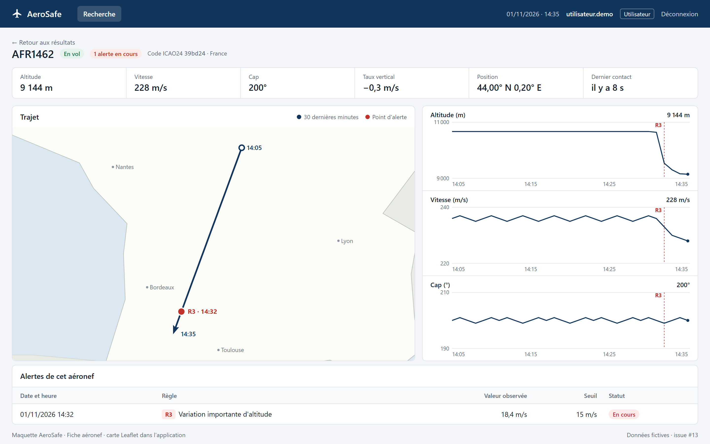
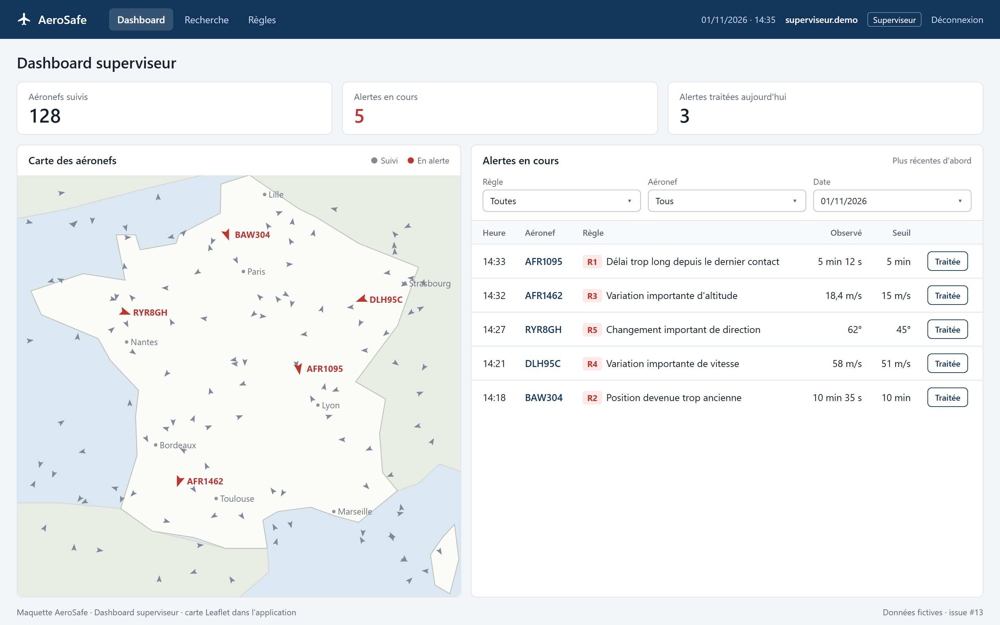

# Maquettes des écrans

Maquettes de l'interface web (issue #13, sprint 3, Teddy). Elles servent de référence pour développer les pages des issues #25 à #28.

Les données affichées sont fictives. Elles sont cohérentes d'un écran à l'autre : l'alerte R3 d'AFR1462 est la même sur le dashboard, dans la recherche et sur la fiche.

## Écrans

| Écran | Image | Rôle | Issue |
|---|---|---|---|
| Connexion | [`01-connexion.png`](01-connexion.png) | Tous | #25 |
| Connexion, erreur de saisie | [`01b-connexion-erreur.png`](01b-connexion-erreur.png) | Tous | #25 |
| Recherche | [`02-recherche.png`](02-recherche.png) | Utilisateur, superviseur | #26 |
| Fiche aéronef | [`03-fiche-avion.png`](03-fiche-avion.png) | Utilisateur, superviseur | #27 |
| Dashboard | [`04-dashboard.png`](04-dashboard.png) | Superviseur | #28, #30 |

### Connexion

### Recherche

### Fiche aéronef

### Dashboard superviseur

## Parcours

1. Après la connexion, l'utilisateur arrive sur la recherche et le superviseur sur le dashboard.
2. Un résultat de recherche ou une ligne d'alerte ouvre la fiche de l'aéronef.
3. Le menu « Règles » (seuils, #29) n'est visible que par le superviseur.

## Choix à valider

- **Statuts d'un aéronef** : `En vol`, `Au sol` et `Contact perdu`. Le dernier correspond à une alerte R1 en cours.
- **Unités** : mètres et m/s, comme dans les données OpenSky et les seuils R1 à R5.
- **Message d'erreur de connexion** : il ne dit pas lequel des deux champs est faux, pour ne pas révéler si un identifiant existe.
- **Bouton « Traitée » et filtres** : ils relèvent de #30 (Should). Le dashboard reste valable pour #28 sans eux.
- **Gravité des alertes** : non représentée, car c'est un bonus (#36). Elle pourra s'ajouter comme colonne du tableau.

Les cartes sont stylisées. Dans l'application, ce sera une carte Leaflet.

## Modifier les maquettes

Les pages HTML sont dans [`sources/`](sources/). Elles s'ouvrent directement dans un navigateur, et les images sont des captures en 1440 × 900 à une densité de 2.

Pour l'écran d'erreur, ajouter `?erreur` à l'URL de `connexion.html`.
