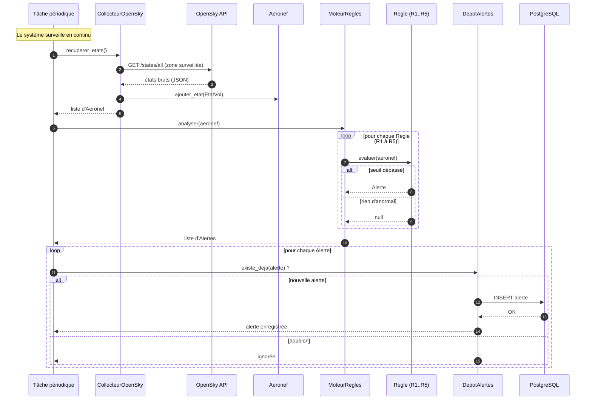

# AeroSafe — Diagramme de séquence

> Scénario principal : **collecte des données de vol → application des règles → génération et enregistrement d'une alerte.**
> Cohérent avec le diagramme de classes (`classes.md`). Rendu automatique sur GitHub ; édition/export : https://mermaid.live

## Lecture du scénario

1. **Collecte** (étapes 1-5) : la tâche périodique demande au `CollecteurOpenSky` de récupérer les données ; celui-ci interroge l'**API OpenSky**, puis construit/alimente les `Aeronef` avec leurs `EtatVol`.
2. **Détection** (étapes 6-12) : le `MoteurRegles` applique **chaque** règle R1→R5 sur l'aéronef (`evaluer()`). Chaque règle renvoie une `Alerte` si son seuil est dépassé, sinon `null`.
3. **Enregistrement** (étapes 13+) : pour chaque alerte, `DepotAlertes` vérifie d'abord `existe_deja()` pour **éviter les doublons** (critère #22), puis insère en base PostgreSQL.

## Légende des symboles

| Symbole | Signification |
|---|---|
| `->>` | message / appel synchrone (A appelle B) |
| `-->>` | réponse / retour de valeur |
| `loop` | répétition (ici : sur chaque règle, puis sur chaque alerte) |
| `alt / else` | embranchement conditionnel (selon que le seuil est dépassé ou non) |
| `autonumber` | numérote les étapes automatiquement |

## Cohérence avec le diagramme de classes

Chaque flèche correspond à une **méthode** du diagramme de classes :
`recuperer_etats()`, `ajouter_etat()`, `analyser()`, `evaluer()`, `existe_deja()`, `enregistrer()`.
Le diagramme de séquence montre **dans quel ordre** ces méthodes s'appellent dans le temps — là où le diagramme de classes montre seulement la structure.
